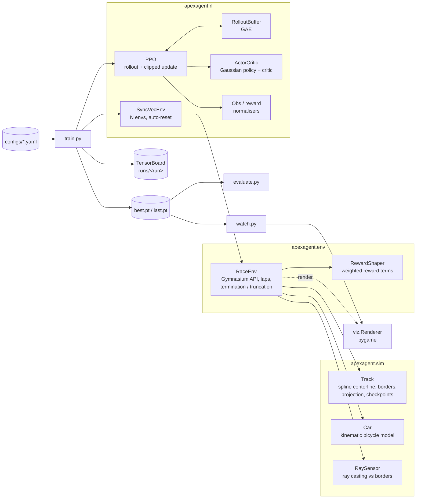

# ApexAgent: a PPO race driver

ApexAgent trains a reinforcement learning agent to drive a car around closed race tracks and
finish laps without help. Everything is written from scratch in Python:

- **Simulator.** Spline-based tracks (three built-in layouts plus procedurally generated ones),
  a kinematic bicycle-model car with a steering slew limit, engine/brake/drag and a tyre-grip
  limit, and LiDAR-style ray sensors.
- **Gymnasium environment** (`ApexRace-v0`). Continuous `[steer, throttle/brake]` actions,
  low-dimensional observations, checkpoint and lap tracking, lap timing, and crash/stall handling.
- **Reward engineering.** A reward made of named, weighted terms (progress, checkpoints, laps,
  speed, centerline, smoothness, wrong-way, crash, time). The weights live in YAML, and each
  term's contribution is logged on its own.
- **PPO from scratch** in PyTorch. Clipped surrogate objective, GAE(λ), value clipping,
  entropy bonus, observation and reward normalisation, LR annealing, KL early stopping, and
  value bootstrapping on time-limit truncation.
- **Real-time visualisation** with pygame. Shows the track, the sensor rays, a trail coloured by
  speed, checkpoint gates and a HUD with lap times, the current actions and the reward
  breakdown for each step.

## Architecture



### Observation and action

| Component | Size | Notes |
|---|---|---|
| Ray distances | 11 | 180° fan, normalised by 60 m range |
| Speed, wheel angle, yaw rate | 3 | scaled to roughly [-1, 1] |
| sin/cos heading error | 2 | car heading relative to the track tangent |
| Lateral offset | 1 | divided by half the track width |
| Curvature preview | 3 | at 10 / 25 / 45 m ahead |
| **Action** | 2 | `steer ∈ [-1,1]`, `throttle ∈ [-1,1]` (negative values brake) |

### Reward design

| Term | Default weight | Purpose |
|---|---|---|
| `progress` | +0.1 / m | Dense signal for distance gained **along the centerline**. Cutting corners off-track and spinning in place earn nothing. |
| `checkpoint` | +2 per gate | Milestone bonus. Only *new* gates count, so the agent can't farm a gate by driving back and forth. |
| `lap` | +25 per lap | Makes finishing a lap the explicit goal. |
| `speed` | +0.02 × v/vmax·cos(θ) | Rewards speed only when it points along the track. |
| `centerline` | −0.05 × (offset/half-width)² | Keeps a safety margin early in training. Small enough that the agent can still learn racing lines. |
| `smoothness` | −0.02 × \|Δsteer\| | Discourages bang-bang steering. |
| `wrong_way` | −0.1 / m backwards | Penalises driving the wrong way. |
| `crash` | −10 (terminal) | Leaving the track ends the episode. |
| `time` | −0.01 / step | Pushes for faster laps. |

Episodes also end early if the car reaches no new checkpoint within `stall_steps` steps, so
the agent can't sit still forever. Checkpoints are counted from where the episode started,
which makes random starts work.

## Getting started

Requires Python 3.10+. A GPU is **not** needed: the policy is a small MLP and the simulator
runs on NumPy, so training runs comfortably on a laptop CPU. No credentials or API keys are needed.

```bash
python -m venv .venv && source .venv/bin/activate
pip install -e ".[viz,dev]"          # or: pip install -r requirements.txt
```

## How to run

**Train**

```bash
python -m apexagent.train                                    # oval + kidney, 3M steps
python -m apexagent.train --config configs/apex_gp.yaml      # harder track + random tracks
python -m apexagent.train --set ppo.total_timesteps=500000 env.tracks=[oval] run_name=quick
python -m apexagent.train --resume runs/quick/last.pt
```

Each run writes `config.yaml`, `best.pt` (picked by evaluation score) and `last.pt` to
`runs/<run_name>/`. Set `train.render_every=N` to watch a live episode every N updates.
This needs a display.

**Monitor**

```bash
tensorboard --logdir runs
```

Logged metrics: episode return, laps, lap/finish/crash rates, best and mean lap time, the mean
of each reward term per step, PPO losses, approx-KL, clip fraction, explained variance and
action std.

**Watch the agent drive (real time)**

```bash
python -m apexagent.watch runs/quick/best.pt
python -m apexagent.watch runs/quick/best.pt --track apex_gp --fps 40
python -m apexagent.watch runs/quick/best.pt --record frames/   # PNG frames for a video/GIF
python -m apexagent.watch --manual --track kidney                # drive it yourself (arrows/WASD)
```

Controls in the viewer: `SPACE` pauses, `R` toggles the rays, `F` fast-forwards, `ESC` quits.

**Evaluate**

```bash
python -m apexagent.evaluate runs/quick/best.pt --episodes 10
python -m apexagent.evaluate runs/quick/best.pt --track apex_gp --track random --json
```

Prints the mean return, mean laps, finish rate, crash rate, and best and mean lap time for each
track. These come from deterministic rollouts that use the mean of the policy.

## How to test

```bash
pytest
```

The tests cover:

- `tests/test_sim.py`: ray/segment geometry, track projection and lap wrap-around, car physics
  (acceleration, steering direction, no reversing under braking, speed cap) and sensors.
- `tests/test_env.py`: Gymnasium API contract, crashes, stall truncation, the reward terms,
  and a scripted pure-pursuit driver that must finish a lap. That last test proves laps are
  reachable and counted correctly.
- `tests/test_ppo.py`: GAE correctness (including episode boundaries), running statistics, and
  a short end-to-end PPO collect-and-update cycle.

The test suite runs headless and does not need pygame.

## Project layout

```
apexagent/
  sim/        geometry.py, track.py, car.py, sensors.py
  env/        race_env.py, reward.py
  rl/         networks.py, buffer.py, normalizer.py, vec_env.py, ppo.py
  viz/        renderer.py
  utils/      logger.py, checkpoint.py, seeding.py
  config.py   factory.py   train.py   evaluate.py   watch.py
configs/      default.yaml, apex_gp.yaml
tests/
```
